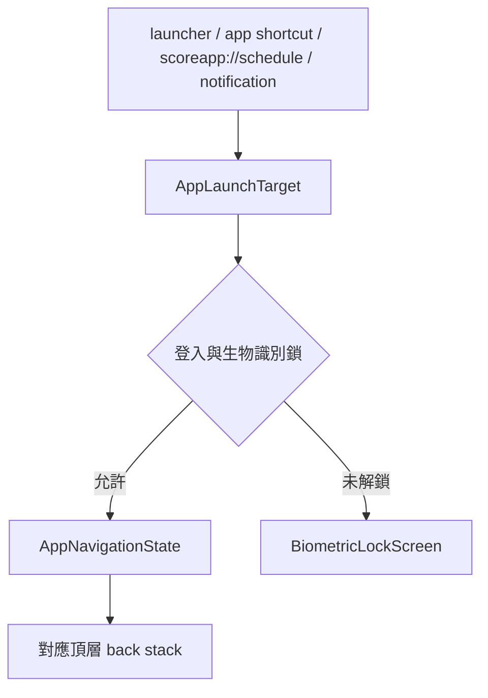

# 導航與外部入口

App shell 不論 Guest 或已登入都使用同一套 Navigation 3。`TopLevelDestination` 宣告「首頁、課表、成績、校園」的順序；`AppNavigationState` 持有四個 `rememberNavBackStack()`，因此切換頂層目的地不會清掉其巢狀返回紀錄。

## Route 與登入狀態

- `AppRoute.authRequirement()` 將 route 分為公開與需要校務 Session 兩類。首頁、校園、公告、行事曆、個人與設定相關頁面維持 Guest 可用；課表、當前課程通知設定、成績、成績模擬器、科目趨勢與校務系統入口需要登入。
- 受保護 route 由 `AuthGate` 顯示行內登入入口；登入完成後只移除登入 route，保留使用者原本想開啟的目的地。課表與成績的未登入畫面共用預設登入提示，不顯示功能頁的上方標題或選項列。
- App 圖示長按的「課表」捷徑使用 `scoreapp://schedule?entry=launcher_shortcut`，建置時依 variant applicationId 產生明確的自身套件與 `MainActivity` 目標，避免 Demo／Debug 入口交給其他安裝版本；沿用 `AppLaunchTarget.Schedule`、首次設定與登入 gate。`entry` 只標記入口來源，不能放入學生資料；處理後清除 Intent data，且不把捷徑誤記為 Widget 開啟。
- 個人頁的「啟動時開啟課表」偏好預設關閉並存在 `app_settings`。只有新建立的 Activity 收到一般桌面 `ACTION_MAIN`、沒有資料 URI 或明確 `AppLaunchTarget` 時，才把偏好轉為既有 `AppLaunchTarget.Schedule`；捷徑、通知及其他指定入口優先；設定載入期間收到的新指定入口同樣優先，套用啟動偏好前須再次確認沒有待處理目標。Android 還原的 Activity back stack 保留原目的地。切換偏好不會改變目前頁面。
- Welcome、外觀、權限、帳號保留同一個 `NavDisplay` 的四個首次設定 route，由 `OnboardingSceneStrategy` 共用固定頁框。只有內容以短距離水平位移與淡入淡出切換，返回鍵、進度列與底部操作位置固定；各步驟保留捲動位置。首次設定期間不顯示 App-level Navigation Bar／Rail。
- 首次設定以 `app_settings` 的 `has_completed_onboarding_v2` 判定。缺少旗標時原子清空 App 設定並寫入 `false`，所以舊版升級會重跑 Welcome；完成或選「稍後登入」後寫入 `true`，後續啟動不再重設。這與 session authority 分開：舊 session 不遷移，私人功能需要重新登入，新格式 VALID session 則保留正常 restore。
- 「個人」同時是 Profile 與設定 Hub，不再建立獨立的 Settings／About route；使用統計、開源授權、開發者選項與背景工作狀態仍是 secondary route。

- `SchoolCalendarRoute(eventId)` 可攜帶公開事件 ID；近期行程與倒數卡片使用此入口，定位並標示對應事件。清單載入後只自動定位一次，計入搜尋列、重複活動提示與日期標題，返回或重組不重設捲動。指定的已結束事件仍保留，來源缺少事件時提示使用者。
- 校園右上角膠囊的搜尋入口開啟公開的 `CampusSearchRoute`，單一關鍵字同時搜尋學校公告與尚未結束的行事曆事件（標題／地點）。兩個既有 ViewModel 由搜尋 route 各自持有，不改原公告頁篩選或行事曆搜尋；公告沿用伺服器搜尋、自動分頁與成功開啟後的已讀處理，事件沿用 `SchoolCalendarRoute(eventId)` 定位。輸入停頓 250ms 後送出，不記錄關鍵字到 Analytics。分類 Chips 只改顯示，不重新查詢；只看行事曆時不預取公告。關鍵字、分類與捲動位置在返回時還原，公告維持既有未讀／置頂優先，不宣稱全庫相關性排序。

頂層首頁沿用 `OverviewRoute`／`TopLevelDestination.Overview` 等內部識別；頁面更名不更動 route、儲存鍵或分析事件 ID。成績摘要是另一個功能，不隨首頁更名。

## 維護規則

- 手機直向使用 `PocketFloatingNavigation`，外層為官方 `HorizontalFloatingToolbar`；四個入口永遠 icon-only，未讀只顯示 dot。寬度達 600dp，或可用高度不足 480dp 時使用 Navigation Rail；兩種版面共用同一選取狀態與四組 stack。
- 頂層導航只在首頁、課表、成績、校園 root 顯示；公告詳情、成績詳情、設定、登入與其他子頁均隱藏，overlay clearance 同步歸零。IME 顯示時 floating toolbar 淡出，不移到鍵盤上方。Toolbar 不接受 contextual action。
- `NavEntry.contentKey` 包含所屬頂層目的地，避免不同 stack 中的「個人」等共用 route 共用 saveable state／ViewModel。切換不 pop；重選先 pop 到 root，在 root 則交給既有 scroll owner 回頂端。重選不重建 route、不觸發 reload 或 haptic。
- Overlay 間距由 shell 的 `LocalNavigationClearance` 統一提供；頁面使用 `PocketScaffold` 安排 Snackbar／FAB，`navigationContentPadding` 加在 scroll content 內。`PocketScaffold` 扣除 overlay 間距時仍保留 `contentWindowInsets` 的系統底部安全間距，即使頁面沒有 bottomBar。自訂 viewport 必須把相同 clearance 加入捲動 extent；原生 WebView 保留安全 viewport。不要在各頁複製 toolbar 尺寸。
- Compact 只觀察已消耗的垂直 user scroll，不消耗手勢或隱藏入口；滑動 indicator、shape morph、icon 與 IME 動效沿用 `PocketMotion`。Haptic 僅在切換不同頂層目的地時發出一次 `SegmentTick`。
- 首頁日期時間由第一張不可編輯卡片連續變形為左上角浮動 pill；右側編輯／個人入口同樣浮在內容上方。頂部不預留 App Bar viewport，內容可捲至系統狀態列；重選首頁重設 grid 捲動，日期卡片同步展開。首頁編輯期間保留手機主導覽與平板 Rail，使編輯與瀏覽維持相同可用寬度；shell 的導航 clearance 不因編輯而改變。編輯模式下方操作列保留可操作的 grid viewport，避免遮住元件或拖曳把手。一般瀏覽模式仍把導航 clearance 留在 scroll extent。
- Selected item 支援水平拖曳：gesture position 僅控制 pill／icon preview，正式 selected semantics 與頁面仍由 navigation state 決定。放手依位置與 velocity 判定並提交一次，取消則回原位；拖曳跨 anchor 的 preview 使用遲滯 `SegmentTick`，release 不重複震動。Tap 保留相鄰 slide／遠距離 fade-through 與 root reselect；子頁仍隱藏 Toolbar。
- 尺寸選擇、裝置驗證與已知限制見 [Floating Navigation 驗證記錄](../design/floating-navigation.md)。

- 新頂層目的地先擴充 `TopLevelDestination` 與 `AppRoute`，不要把 state 藏在 Navigation Bar／Rail Composable。
- 外部入口先轉為 `AppLaunchTarget`；Widget、deep link 與通知不得在 UI 內另建 navigation state。
- 不要在根層、登入頁或成績頁各自用 `BackHandler` 重複攔截 Predictive Back；交由 `NavDisplay`。
- 成績頁的「摘要、科目、分析」是 feature 內 secondary navigation，固定浮在底部主導覽上方，位於內容的最上層，不隨內容捲動。預設收合為三點指示器，較大且高亮的圓點對應目前分頁；點擊展開半透明膠囊，選擇分頁或點擊膠囊外側後收合；外側偵測不消耗手勢，保留內容點擊與捲動，離開頁面或重選成績主導覽同樣收合，左右滑動仍同步更新指示器。往下捲動沿用 shell 的 compact 訊號，膠囊淡出並從中心輕微縮至 94% 後隱藏，反向捲動或重選成績主導覽時淡入並恢復大小；淡出沿用 default effects，縮放沿用 Expressive contentReflow；隱藏過渡期間仍隨導覽列上緣下移；膠囊以明確的寬度動畫從中心沿用 Expressive contentReflow 彈簧收合，文字與圓點交叉淡入淡出；退出的分頁文字保持展開寬度，避免文字被擠壓或大幅橫移；點擊圓點同時重設 shell compact，讓再次往下捲動仍可同步收合。分頁最少 48dp 且隨字體增加高度，其高度及間距加入 feature 內的 LocalNavigationClearance，內容與 Snackbar 同步避讓；Rail 版面同樣固定在內容區底部。
- 成績科目卡片展開時優先顯示頂端，保留系統狀態列及右上操作膠囊的實際高度；整張卡片連同安全間距放得下時，才捲動至底端避開主導覽。卡片過高時對齊頂端，讓使用者往下閱讀。自動定位不為半透明的「摘要、科目、分析」分頁額外避讓；列表原有捲動留白與 Snackbar 避讓不變。
- 課表／成績／校園使用 RootFloatingScaffold，將品牌列與頂部安全間距放進捲動內容，不縮小 viewport；PocketBrand 與首頁共用 SVG 衍生向量、Outfit 與動態色彩規則。右側操作膠囊常駐，按鈕形狀固定。成績的「選擇成績」按鈕展開學期／考試 split button；分頁固定浮在主導覽上方。Guest／restore 保留品牌及個人入口，AuthGate 繼續負責私人資料。

- 頂層切換的 entry transition 為 None；內容透過 `rootBodyMotion()` 使用同一個 NavDisplay AnimatedContent scope，只做輕微位移，不做淡入／淡出，避免新頁背景先遮住舊內容後出現空白；品牌與操作膠囊不參與位移。課表直接在同一個 Compose composition 繪製，另存圖片使用 GraphicsLayer 擷取，不為匯出建立嵌入式 ComposeView，避免切換時等待 View 重新繪製。子頁轉場維持既有 slide／fade。

- 頂層頁使用 `RootSceneStrategy` 保留首頁 composition，避免返回時重建並測量全部可見 widget。隱藏首頁維持 CREATED lifecycle、不放置或繪製內容、不提供 accessibility 子節點及 root reselect callback；其他目的地的返回紀錄不變。首次設定使用獨立的 `OnboardingSceneStrategy`；登入與其他子頁仍交由預設 SceneStrategy。
